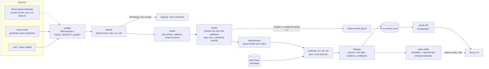

# PaperTrail

**Your inbox already knows what you're owed.**

PaperTrail reads your shopping email (read-only), turns every purchase into a ledger row, and runs deterministic
rules to find money stores owe you: refunds that are overdue or short, return windows about to close, and price
drops you could claim. The result is one number, **"You're owed $X"**. Every finding cites the source-email quote and a
confidence score, and comes with a drafted claim that you review, approve, and send yourself.

Built at LA Hacks 2026. This is a hackathon project and still a work in progress; see [Status](#status).

## The problem

Online shoppers lose money after checkout without noticing it. A return gets received but the refund never shows up,
a refund comes back a few dollars short, a 30-day return window closes while the box sits in the hallway, or the
price drops a week after purchase while the store's price-adjustment window is still open. All the evidence is
already in the inbox: order confirmations, shipping and delivery notices, return labels, refund emails. Nobody reads
them side by side.

## What it does

- **Ledger:** every order confirmation, shipping, delivery, return, refund, price-adjustment and cancellation email
  is grouped into one order with a timeline.
- **Refunds owed (R1):** a return was received or dropped off and no refund arrived within the SLA, or the refund was
  smaller than expected.
- **Return deadlines (R2):** the return window closes within 7 days and no return has started.
- **Price drops (R3):** the current price of an item you bought is lower by at least max($5, 5%) while the
  price-adjustment window is open.
- **Evidence on every number:** each finding links to a source quote (200 characters max), the rule and its inputs,
  and a confidence score.
- **Drafted claims you approve:** a templated email that cites the order ref, amounts, dates and policy quote. An
  optional LLM pass may only reword it and is rejected if any fact changes. You copy it or open it in your own mail
  client (`mailto:`).
- **Needs-review queue:** anything uncertain (confidence below 0.7, failed validation, missing order confirmation)
  goes to a review queue instead of the total.

## What it will NOT do

- **Send email.** Claims are copy-to-clipboard or `mailto:` only, after you approve them.
- **Move money.** There is no payment integration of any kind.
- **Write to Gmail.** The only Gmail scope requested is `gmail.readonly`, so the app cannot send, delete, label,
  or mark messages read.
- Store raw email bodies, or send unredacted personal data to the LLM.

## Status

What is on `main` today:

| Area | State |
|---|---|
| Ingestion: prefilter, PII redaction, rules-based classifier | done (#6, #33) |
| LLM extraction (Claude, Zod-validated, cached) | done (#7) |
| Order matching and dedupe | done (#8) |
| Rules R1 refund, R2 return deadline, R3 price drop | done (#13, #14, #15) |
| Claim draft generation + fact-checked rephrase (library) | done (#32) |
| Demo pipeline, `.eml`/`.mbox` upload, in-memory store, JSON API, typed client | done (#4, #31), see [docs/api.md](docs/api.md) |
| Eval harness, `GET /api/eval`, CI gate | done (#21, #33) |
| Gmail OAuth connect (PKCE, encrypted tokens, `gmail.readonly`) | on `main` (#3, still open) |
| Gmail message sync into the pipeline | not built yet |
| Claims API routes (draft, edit, approve) | in progress (#35) |
| Dev test playground + manual test plan | in progress (#34) |
| UI | being redesigned in Paper by Alex; pages still render synthetic mock data from `src/lib/mock/data.ts` (the connect screen starts the real OAuth flow) |
| Rewards / loyalty (L3), Playwright e2e | not started (#18, #22) |

## Architecture



Classification runs on the raw email before redaction. It is local deterministic code (no LLM), and it needs the real
sender domain to catch phishing look-alikes in forwarded mail. Only the redacted email reaches extraction.

Module map:

| Folder | What it holds |
|---|---|
| `src/lib/contracts/` | Canonical Zod schemas: `RawEmail`, `RedactedEmail`, `Classification`, `Extraction`, `NormalizedOrder`, `Finding`, seed file formats |
| `src/lib/ingestion/` | `isReceiptLike`, `GMAIL_RECEIPT_QUERY`, `redact`, `classify`, `extract`, extraction prompt, cache |
| `src/lib/llm/` | Anthropic Messages API client over `fetch` (no SDK) and an offline `FixtureLlmClient` |
| `src/lib/orders/` | `matchOrders`: emails to `NormalizedOrder` with events, policy and `needsReview` |
| `src/lib/rules/` | `runRules`, `refundRule` (R1), `returnRule` (R2), `priceDropRule` (R3), money/time helpers |
| `src/lib/prices/` | Price feed schema, `latestPrice`, `mergeFeeds` |
| `src/lib/claims/` | `draftClaim`, `rephraseDraft` + `factCheckRephrase`, `mailtoUrl`, `clipboardText` |
| `src/lib/pipeline/` | `runPipeline` (shared by demo, upload and future Gmail sync), extractors, gold-label adapter |
| `src/lib/demo/` | `loadSeedDemo`, `parseEml` / `parseMbox`, upload pipeline |
| `src/lib/store/` | In-memory session store, audit log, merchant exclusion, `deleteAll` |
| `src/lib/api/` | JSON API response types and the typed client the UI uses |
| `src/lib/eval/` | Eval metrics, `runEval`, CI gate test |
| `src/lib/auth/` | Gmail OAuth (PKCE, AES-256-GCM token sealing, session) |
| `src/db/schema/` | Drizzle schema (users, orders, findings, audit) |
| `seed/` | Synthetic inbox, gold labels, expected findings, simulated price feed ([seed/README.md](seed/README.md)) |

Stage-by-stage detail, rule semantics and privacy boundaries: [docs/architecture.md](docs/architecture.md).
HTTP routes: [docs/api.md](docs/api.md).

## Tech stack

- Next.js 15 (App Router, route handlers for the API), React 19, TypeScript 5 (strict)
- Tailwind CSS 3, Framer Motion 12
- Drizzle ORM on SQLite (`better-sqlite3`)
- Zod 3 for every LLM input/output and API contract
- Anthropic Messages API (Claude) for extraction and optional claim rewording; default model `claude-haiku-5-5`,
  override with `LLM_MODEL`
- Vitest 3 for unit/integration tests, Playwright configured for e2e (specs come with #22)
- GitHub Actions CI: lint, typecheck, test on every push (`.github/workflows/ci.yml`)

## Setup and run

Prerequisites: Node.js 22 LTS recommended (CI uses Node 20; Node 25 works but may compile `better-sqlite3`), npm.

```bash
npm ci
cp .env.example .env.local        # PowerShell: Copy-Item .env.example .env.local
npm run dev                        # http://localhost:3000
```

Environment variables (`.env.example` documents each one):

| Variable | Needed for |
|---|---|
| `ANTHROPIC_API_KEY` | Optional. Live extraction for uploaded `.eml`/`.mbox` files. Without it, uploads that miss the cache go to the needs-review queue. Demo mode never needs it. |
| `LLM_MODEL` | Optional model override (default `claude-haiku-5-5`) |
| `GOOGLE_CLIENT_ID`, `GOOGLE_CLIENT_SECRET` | Gmail connect. The OAuth client's redirect URI must be `<AUTH_BASE_URL>/api/auth/callback`. |
| `AUTH_ENCRYPTION_KEY` | Gmail connect: 64 hex chars, e.g. `openssl rand -hex 32` |
| `AUTH_BASE_URL` | Gmail connect: exact app origin, default `http://localhost:3000` |
| `DATABASE_URL` | SQLite file for OAuth tokens and auth audit rows, default `./papertrail.sqlite` |

Checks (all three must pass before a push):

```bash
npm run lint
npm run typecheck
npm test                           # vitest run
```

### Demo mode (no keys needed)

Demo mode runs the synthetic seed inbox (`seed/inbox.json`, 78 emails) through the same pipeline as real mail, fully
offline. It uses recorded LLM output from `seed/llm-cache.json` when that file exists. Otherwise it uses the seed
gold labels as precomputed extractions, which are marked `model: "gold"`, audited as "no LLM call", and shown with
the label "Extracted from precomputed seed labels (no LLM call)".

With `npm run dev` running:

```bash
curl -X POST http://localhost:3000/api/demo     # load the synthetic seed through the pipeline
curl http://localhost:3000/api/ledger           # orders, findings, owed summary, review queue, labels
curl http://localhost:3000/api/audit            # audit log
curl -X POST http://localhost:3000/api/delete-all
```

(On Windows PowerShell use `curl.exe`, or `Invoke-RestMethod -Method Post http://localhost:3000/api/demo`.)

The pages at `/`, `/ledger`, `/review`, `/claim/[id]`, `/trust` and `/sync` currently show synthetic mock data from
`src/lib/mock/data.ts` and are not wired to the JSON API yet; the Paper redesign is replacing them. The "Connect
Gmail" button on `/connect` starts the real OAuth flow (`/api/auth/google`), which needs the Google variables above.

### Playground and manual test plan

`npm run playground` (a dev-only playground for every backend feature) and `docs/manual-test-plan.md` are
**coming with #34**. Neither exists on `main` yet.

## Trust and safety

- **Read-only Gmail.** The OAuth flow requests only `https://www.googleapis.com/auth/gmail.readonly` (PKCE + state,
  `access_type=offline`). Tokens are sealed with AES-256-GCM before they are stored.
- **Narrow fetch.** Gmail search is limited to receipt-like mail from the last 90 days (`GMAIL_RECEIPT_QUERY`).
  `GET /api/prefilter` returns the exact query and a plain-language description to show before a sync.
- **Redaction before any LLM call.** Card numbers (Luhn-checked), phone numbers, street addresses and email addresses
  are replaced with tokens such as `[PAN_1]`. The extraction prompt contains only the sender domain, the email date,
  and the redacted subject and body. Raw bodies are never stored.
- **Numbers come from rules, not the LLM.** The LLM extracts fields and may reword a claim. Every amount and date in a
  finding is computed by deterministic, versioned rules (`R1@1`, `R2@1`, `R3@1`) that take `now` as a parameter.
  A rephrased claim is discarded if any cited fact changes or a new number appears.
- **Every LLM output is Zod-validated.** Invalid output is retried once, then routed to the needs-review queue. Nothing
  is dropped silently.
- **Needs-review threshold 0.7.** Orders whose lowest extraction confidence is below 0.7, or that have no order
  confirmation or currency, produce no findings and are excluded from the owed total until a human confirms them.
- **Audit log.** Pipeline runs, every LLM call or cache hit (model, token counts, number of redacted tokens; never
  email text), demo resets and deletes are recorded and served at `GET /api/audit`. OAuth Gmail fetches are written
  to the SQLite `audit` table.
- **Delete everything.** `POST /api/delete-all` purges orders, findings, drafts, the review queue, the extraction cache,
  merchant exclusions and the audit log, leaving one `delete` record. OAuth token revocation is a hook
  (`setRevokeOAuthHook`) that #3 has not registered yet, so the response currently reports `revokedToken: false`
  and the encrypted OAuth token in SQLite is not touched.
- **Merchant exclusion.** `POST /api/merchants/exclude` hides a merchant from every response.

## Evaluation

The harness (`src/lib/eval`, issue #21) scores the pipeline against the synthetic seed:

- **Classification:** accuracy and macro-F1 of the rules-based `classify()` over all 78 emails, the 63-email dev split
  and the 15-email holdout split, plus a confusion matrix.
- **Safety:** number of phishing look-alike or marketing emails routed to an order class (must be 0).
- **Findings:** precision/recall against `seed/expected_findings.json` (14 findings) in two modes.
  *Oracle extraction* feeds gold-label extractions straight into the matcher and rules (tests matcher + rules).
  *Realistic routing* lets `classify()` decide which emails get extracted, then uses gold-label extractions.
  Neither mode uses real Claude output yet.
- **Extraction field accuracy:** per-field exact match against gold labels. It needs real model output (an extraction
  map keyed by `textHash`) and is reported as "not run" without one.

How to run it:

- `GET /api/eval` returns the full JSON report (with `npm run dev` running).
- `$env:WRITE_EVAL='1'; npx vitest run scripts/run-eval.test.ts` (PowerShell) writes `eval/latest.json` and prints a
  summary table.
- `src/lib/eval/gate.test.ts` runs in `npm test` (and CI). It requires a 15-email holdout, zero phishing/marketing
  routed as orders, exact oracle findings, and realistic-routing recall ≥ 0.90 and precision ≥ 0.95.

**Snapshot, 2026-10-17, `main` at 887ad3a. All numbers are on SYNTHETIC data** (78 generated emails from 8 fictional
stores), not on real inboxes:

| Metric | Value |
|---|---|
| Classifier macro-F1, all / dev / holdout | 1.000 / 1.000 / 1.000 |
| Phishing or marketing routed as an order | 0 |
| Findings, oracle extraction: precision / recall | 1.00 / 1.00 (14/14, 0 false alarms) |
| Findings, realistic routing: precision / recall | 1.00 / 1.00 (14/14, 0 false alarms) |
| Extraction field accuracy | not yet measured (needs real Claude outputs) |
| CI gate | passing |

Read these with care. The classifier is hand-written rules tuned on this same synthetic seed. The holdout is only 15
emails and is not fully blind: classifier fixes in #33 were made while its failures were visible. Findings numbers
use gold-label extractions, so they measure routing, matching and rules, not LLM extraction quality.

## Disclosures

- **All demo data is synthetic.** The seed stores (Bazaarly, Grandmart, Voltline Electronics, Northwind Outfitters,
  Lumen Beauty, Oakhaven Home, FreshCart Grocery, Brewbox Coffee) are fictional and use reserved `.example` domains.
  The customer, addresses and `555-01xx` phone numbers are invented; the full card numbers are public test numbers.
  The API labels demo data "Demo data — synthetic". See [seed/README.md](seed/README.md).
- **The price feed is simulated.** `seed/price-feed.json` is scripted (`"simulated": true`). Findings based on it carry
  `simulated: true`, cite "Simulated price feed" as evidence, and claim drafts add a warning to verify the price.
- **Google OAuth app is in Testing mode.** `gmail.readonly` is a restricted scope and the app is not verified. Only
  allow-listed test users can connect, Google shows an "unverified app" warning, and consent expires after 7 days.
  Judges without a test-user invite should use demo mode.
- **No payments, no Visa API.** Nothing in the app moves money or calls a Visa (or any payment) API.
- **Reward rates:** the rewards layer (#18) is not built. If it ships, its rates are illustrative presets, not issuer
  data.

## Sponsor tracks

### Visa: Future of Shopping

PaperTrail is a post-purchase shopping assistant. Stages covered today: **post-purchase** (refunds, returns, price
adjustments). The extraction schema also captures the card's last 4 digits (payments context), but there is no
checkout, payment or loyalty feature yet; rewards (#18) is not started.

| Criterion (weight) | How PaperTrail addresses it |
|---|---|
| Innovation (25) | The inbox is the source of truth: claims are backed by the store's own emails, with a quote and confidence for every dollar |
| User experience (25) | One "You're owed $X" number, a "Why?" explanation per finding, and a claim draft ready to approve (UI being redesigned in Paper) |
| Technical (20) | Typed pipeline (prefilter, redact, classify, extract, match, rules), Zod-validated LLM I/O with retry and cache, pure clock-injected rules, eval harness with a CI gate |
| Commerce impact (15) | Recovers money shoppers already lost: overdue and short refunds, missed return windows, price drops |
| Trust and responsibility (15) | Read-only scope, redaction before the LLM, numbers from rules only, human approval before anything leaves, audit log, delete-all, review queue below 0.7 confidence, honest synthetic/simulated labels |

### Paper: Best Designed Hack

Alex (@ptatoo) is redesigning the UI in Paper. The current design direction, tokens and components are documented
in [docs/design-system.md](docs/design-system.md): a neumorphic "soft UI" on one cool-slate surface, a single teal
accent, money values in a Fraunces serif, and tabular figures, referencing the Paper file's "Soft UI" artboards.
The UI reads data only through the typed client (`src/lib/api/client.ts`) and `@/lib/contracts`, so the redesign can
replace any page without backend changes.

> **TODO (Alex):** design rationale, screenshots of the Paper artboards and the shipped screens, and the
> Paper-designed cover image.

### How AI agents built this project

Most code on `main` was written by AI coding agents working under human direction, coordinated through GitHub
Issues as the only status board ([COORDINATION.md](COORDINATION.md), [AGENTS.md](AGENTS.md)):

- Every unit of work is an issue. An agent claims it with an ID such as `kenan-pi-7`, `alex-pi-ui-1` or
  `chelsea-codex-1`, posts progress, and hands off with a `DONE` comment that names the real commit SHA.
- Kenan's backend work ran as orchestrated pi agents: one orchestrator agent reviews each worker's commit (made in
  its own git worktree) before pushing to `main` and posting the handoff.
- Every commit carries an `Agent: <id>` trailer, so `git log` shows which agent produced each change.
- Ownership is explicit: frontend/design belongs to Alex and his agents, Gmail OAuth to Chelsea; other agents do not
  edit those files and coordinate interface changes through `INTERFACE` comments.

Sentry is not used.

## Team

| Name | GitHub | Role |
|---|---|---|
| Kenan | [@VeneratedApotheosis](https://github.com/VeneratedApotheosis) | Repo owner, scope, backend (via orchestrated agents) |
| Alex | [@ptatoo](https://github.com/ptatoo) | Frontend and design (Paper), scaffold |
| Chelsea | [@chelsearwang](https://github.com/chelsearwang) | Gmail OAuth, backend |

## Contributing

Read [AGENTS.md](AGENTS.md) and [COORDINATION.md](COORDINATION.md) first. Claim an issue on GitHub before starting,
stay inside the files it names, and run `npm run lint`, `npm run typecheck` and `npm test` before every push.

## License

TBD. No license has been chosen yet.
