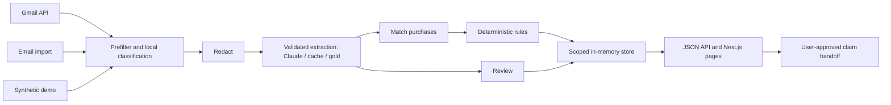

# PaperTrail

**Your inbox already knows what you're owed.** PaperTrail reads receipt-like email, groups it into purchases, and uses deterministic rules to find overdue or short refunds, closing return windows, and price drops. Each finding includes evidence, confidence, and a claim draft you approve and send yourself.

Built for LA Hacks 2026. The app uses read-only Gmail access and never sends email or moves money.

## What works today

| Screen | What it does |
|---|---|
| Owed to you (`/`) | Money-back findings with source quotes and “Why?” explanations |
| Purchases (`/ledger`) | Search/filter purchases and open their timelines and evidence |
| Review (`/review`) | Correct and confirm uncertain purchases; unreadable emails stay visible separately |
| Claim (`/claim/[id]`) | Edit, save, approve and copy a draft; open your own email client after approval |
| Trust (`/trust`) | Audit history, merchant exclusions, and delete everything with a receipt |
| Account (`/account`) | Gmail connection, last sync, counts, and disconnect controls |
| Sync (`/sync`) | Preview and confirm Gmail sync, import `.eml`/`.mbox`, or try synthetic demo data |
| Evaluation (`/eval`) | Held-out synthetic classifier scores from `/api/eval`, with evaluation limitations |

Live Gmail sync, the offline demo, and imported email use the same ingestion/matching/rules pipeline. Low-confidence purchases are excluded from owed totals until confirmed. Claim approval records a handoff; PaperTrail does not verify that you sent the email or received money. Approved drafts survive pipeline reruns when their finding survives, with warnings if underlying facts change.

Amounts are computed by rules, not generated by AI. The summary API keeps different currencies separate (`owedByCurrency`); the primary headline does not add them together or convert exchange rates.

## Run locally

Use **Node.js 22 LTS** (see `.nvmrc`; CI uses Node 22) and npm.

```bash
npm ci
cp .env.example .env.local
npm run dev
```

Open `http://localhost:3000`, then choose **Try demo data**. This product demo needs no Google or Anthropic credentials. On PowerShell, use `Copy-Item .env.example .env.local` instead of `cp`.

To use another port: `npm run dev -- --port 3300`. For OAuth, set `AUTH_BASE_URL` to that exact origin and register the matching callback URL in Google Cloud.

### Optional live Gmail and extraction

Create your own local `.env.local` using the placeholders in `.env.example`. Keep it and all credentials out of Git.

| Variable | Purpose |
|---|---|
| `GOOGLE_CLIENT_ID`, `GOOGLE_CLIENT_SECRET` | Google Web OAuth client for Gmail |
| `AUTH_BASE_URL` | App origin; defaults to `http://localhost:3000` |
| `AUTH_ENCRYPTION_KEY` | 64 hex characters for token/session sealing; generate with `openssl rand -hex 32` |
| `ANTHROPIC_API_KEY` | Live Claude extraction for Gmail/import cache misses, and optional claim rewording |
| `LLM_MODEL` | Optional model override; the code default is `claude-haiku-5-5` |
| `DATABASE_URL` | SQLite file for auth identity, sealed tokens and persistent auth audit; defaults to `./papertrail.sqlite` |

`ANTHROPIC_API_KEY` may be set in the OS/user environment instead of the file. An existing environment value takes precedence over `.env.local`. Restart the app after changing configuration. The configured model must be available to your Anthropic account.

Register `<AUTH_BASE_URL>/api/auth/callback` as the OAuth client's authorized redirect URI. The app requests only `https://www.googleapis.com/auth/gmail.readonly`. The demo Google Cloud setup uses **Testing mode**: the Google account must be on that project's test-user list. Google verification and test-user eligibility are console settings, not settings this repository can change. Use the synthetic demo if Google blocks access.

Connect Gmail, review the search preview, then explicitly start sync. The current batch searches the last 90 days and fetches up to 50 matching messages. Gmail extraction requires a key or cached results; a provider failure leaves the previous ledger in place. Uploaded cache misses without a key go to Review.

### Product app versus development QA

- `npm run dev`: the real Next.js application. Use **Try demo data** inside it for the product demo.
- `npm run qa`: developer launcher that starts or reuses Next.js, starts the backend playground, preloads synthetic demo data and opens a browser. `npm run demo` is its older alias.
- `npm run playground`: backend QA playground alone; see [manual test plan](docs/manual-test-plan.md).
- `npm run build` then `npm start`: production build and server.

The QA launcher accepts `PT_API_PORT` and `--no-open`. It is a development tool, not the product UI.

## How Gmail data is read

PaperTrail uses Gmail API message listing and full-message retrieval with a receipt-focused query, shown before sync. It walks nested MIME parts, ignores attachments, and selects plain text or converts the richer HTML body to text. Conversion runs as text processing: it executes no email JavaScript and loads no remote email resources.

The local deterministic classifier handles receipt types and phishing/marketing exclusions. Redaction is controlled by `PAPERTRAIL_REDACT` (`on`|`off`, **default `off`** for the local demo, [#125](https://github.com/VeneratedApotheosis/Paper-Trail/issues/125)): when it is `off`, Claude receives the full receipt text (HTML is still dropped) so it can read tracking numbers and similar details, and the app says so in its copy; set `on` for anything other than local/demo use. When `on`, before Claude extraction `redact()` replaces recognized card numbers, phone numbers, street/postal addresses, email addresses and recognized customer names with tokens. The prompt includes the sender domain, date, and redacted subject/body, not full From/To headers. Claude output is Zod-validated, retried once after invalid output, and otherwise routed to Review. The matcher groups extracted events into orders; pure rules compute every amount and deadline.

Redaction covers the international/contextual phone, postal-line and customer-name cases added in [#94](https://github.com/VeneratedApotheosis/Paper-Trail/issues/94) and is context-gated so prices, dates, brands and order references survive ([#123](https://github.com/VeneratedApotheosis/Paper-Trail/issues/123); coverage and limits in `docs/architecture.md`). It remains pattern-based and Latin-script, not a guarantee that every piece of personal information is removed. With redaction `off` the receipt text that is kept for Review/quality labels is the unredacted text (it stays local: in memory, plus the local SQLite label store). Raw full email bodies are processed in memory rather than persisted (except as just described); extracted fields and bounded evidence quotes are retained.

## Data, trust and limitations

- **Synthetic demo:** seed emails, customers and merchants are fictional and labeled in the app. Demo extraction uses a recorded seed cache when available, otherwise precomputed gold labels; it makes no live provider calls.
- **Simulated prices:** the seed price feed is simulated, and findings/drafts based on it carry a warning. There is no live store-price scraper or payment integration.
- **Storage:** purchase state, findings, drafts, review items, extraction cache and app audit are in process memory, scoped separately for signed-in accounts. Anonymous demo/upload visitors share the anonymous store. A server restart loses this state; SQLite auth persistence does not make the ledger persistent.
- **Disconnect:** clears local Gmail credentials and attempts Google revocation, retaining the signed-in identity and existing purchases.
- **Delete everything:** purges the active store, removes the account identity/credentials when signed in, clears cookies, and attempts Google revocation. The receipt reports the actual purge counts and whether revocation was confirmed. A persistent `oauth.deleted` row retains no subject identity.
- **Audit:** Gmail fetches, provider attempts (including failures), approvals and deletes are recorded. SQLite auth audit and the app audit endpoint remain separate. Cached/gold extractions are counted by source in pipeline statistics; only real provider attempts produce `llm_call` rows.
- **Review:** confidence below 0.7 or missing required purchase facts prevents inclusion in owed totals. Rules depend on the policy evidence/defaults available; users should check the original merchant terms.

## Architecture and project structure



| Directory | Responsibility |
|---|---|
| `src/app/` | Thin page wrappers and Next.js API route handlers |
| `src/components/`, `src/hooks/` | Props-driven views and shared client data/action hooks |
| `src/lib/contracts/` | Canonical Zod data schemas |
| `src/lib/ingestion/`, `llm/` | MIME text processing, prefilter, classification, redaction, validated extraction and cache |
| `src/lib/gmail/`, `auth/` | Bounded Gmail sync, progress, OAuth and sealed sessions |
| `src/lib/pipeline/`, `orders/`, `rules/` | Streaming pipeline, order matcher and deterministic findings |
| `src/lib/store/`, `api/`, `review/`, `claims/` | Scoped state, typed API helpers, review revisions and drafts |
| `src/db/schema/` | Drizzle schemas; auth initializes its SQLite tables |
| `seed/`, `src/lib/eval/`, `scripts/` | Synthetic fixtures, evaluation and generators |
| `e2e/`, `tools/` | Playwright journeys and development QA tools |

Stack: Next.js 15 App Router, React 19, strict TypeScript, Tailwind CSS 3, Framer Motion, Zod, Drizzle/SQLite (`better-sqlite3`), Vitest and Playwright. The UI follows Alex's [design system](docs/design-system.md): slate surface, teal accent, Spectral headings and Hanken Grotesk UI text.

See [architecture](docs/architecture.md), [API reference](docs/api.md), [Gmail sync](docs/gmail-sync.md), and [seed documentation](seed/README.md).

## Evaluation and checks

```bash
npm run lint
npm run typecheck
npm test
npm run build
npx playwright install chromium
npx playwright test
```

Playwright starts a dedicated production server on port 3107, with synthetic configuration. Tests cover demo findings/evidence, claim approval, purchases/detail, deletion, import preview, evaluation retry, and detail 404 behavior. Tests do not call real Google, Gmail or Anthropic APIs. CI runs lint, typecheck, unit tests, a production build and Chromium journeys on Node 22.

`GET /api/eval` reports classification metrics on all/dev/holdout splits, extraction field accuracy when actual extraction outputs are supplied, and finding precision/recall in oracle-extraction and realistic-routing modes. `/eval` displays held-out classifier metrics, not live Claude accuracy.

The gate in `src/lib/eval/gate.test.ts` requires a 15-email holdout, no phishing/marketing routed as purchases, exact oracle findings, and realistic-routing recall ≥0.90 / precision ≥0.95. Gold-label extraction evaluates matching/rules rather than model extraction quality. The small synthetic holdout has been visible during development; these results do not establish accuracy on real inboxes. See the API for current numbers rather than a stale README snapshot.

## Team and collaboration

| Person | GitHub | Contribution |
|---|---|---|
| Kenan | [@VeneratedApotheosis](https://github.com/VeneratedApotheosis) | Scope, data, routing and backend through coding agents |
| Alex | [@ptatoo](https://github.com/ptatoo) | Paper design, visual components and scaffold |
| Chelsea | [@chelsearwang](https://github.com/chelsearwang) | OAuth/Gmail/backend and reserved implementation queues through Codex |
| Ethan Lowe | [@ethanwlowe7-cmyk](https://github.com/ethanwlowe7-cmyk) | Team member; currently inactive |

Coding agents work under human direction, with claims, interface decisions and commit-SHA handoffs on GitHub. Read [AGENTS.md](AGENTS.md) and [COORDINATION.md](COORDINATION.md) before contributing. Claim one issue, use an isolated worktree, respect file ownership, and pass lint/typecheck/tests before pushing. Agent commits include an `Agent:` trailer. Devin/Cognition is not used. Paper and Visa are the documented sponsor targets; the app does not call Visa or another payment API.

## License

No license has been selected.
